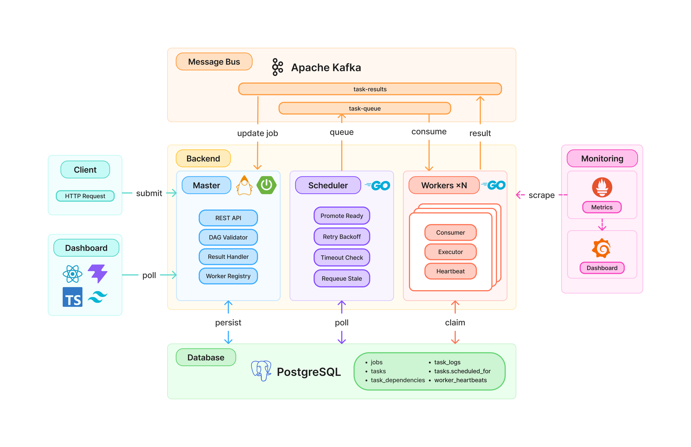
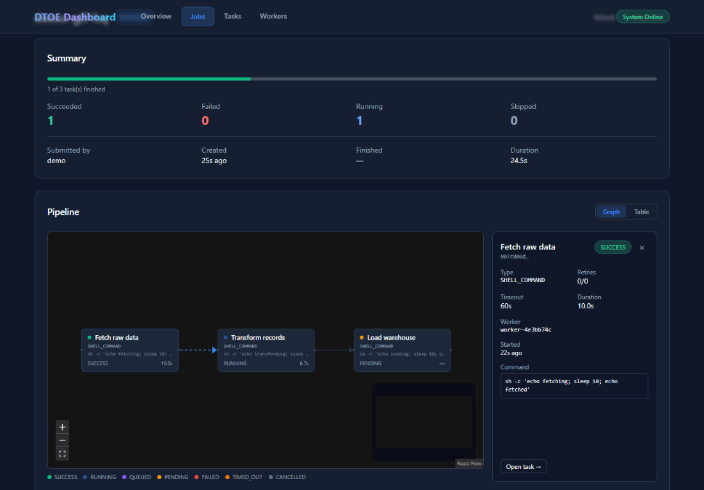

# ⚙️ DTOE — Distributed Task Orchestration Engine

> A lightweight, production-grade distributed job scheduler and worker pool — built from scratch with Java, Go, Kafka, PostgreSQL, and React.

---

## What Is DTOE?

DTOE (pronounced *"dee-toe"*) is a mini Apache Airflow / Celery implementation that lets you define, schedule, and monitor **directed acyclic graphs (DAGs) of tasks** via a REST API. A Java control plane validates and persists the graph, a Go scheduler promotes ready tasks into Kafka, and a fleet of stateless Go workers execute them concurrently — reporting status back to a shared PostgreSQL database.

The React console turns that state into an Airflow-style workspace: searchable job/task lists, a live interactive DAG with a per-task inspector, task payloads (the actual shell command), errors, and logs.

---

## Architecture



- **Master (Java/Spring Boot)** — REST API, DAG validation, result consumer, worker registry. It never touches the task queue.
- **Scheduler (Go)** — the single writer of `task-queue`: promotes dependency-ready tasks, applies retry backoff, enforces timeouts, requeues stranded work.
- **Workers (Go ×N)** — claim a task with a conditional state transition, execute it (shell/HTTP/no-op), publish the result, write heartbeats.
- **Kafka** — `task-queue` (work) and `task-results` (outcomes), both at-least-once.
- **PostgreSQL** — jobs, tasks, dependencies, logs, worker heartbeats.
- **Console + monitoring** — React dashboard, Prometheus scrape, Grafana dashboards.

---

## Key Features

| Feature | Description |
|---|---|
| **DAG Scheduling** | Define jobs as JSON graphs of tasks with dependencies; cycles are rejected at submit time |
| **REST API** | Submit, cancel and inspect jobs and tasks over HTTP |
| **Kafka-backed Queue** | Durable, partitioned task queue with replay support |
| **Distributed Workers** | Horizontally scalable Go worker pool with heartbeating and capacity tracking |
| **Retry Engine** | Configurable retries with exponential backoff, driven entirely by the scheduler |
| **Timeout Handling** | Per-task deadlines enforced by the scheduler, with a grace period for in-flight results |
| **At-most-once execution** | Workers claim tasks with a conditional `QUEUED → RUNNING` update instead of a lock |
| **Worker registry** | Live/inactive worker views plus a 24h heartbeat retention job (`DTOE_WORKER_RETENTION_HOURS`) |
| **Searchable console** | Job/task search, status filters, page size and pagination stored in the URL |
| **Interactive DAG** | React Flow + dagre graph with status colours, edge highlighting and click-to-inspect |
| **Task forensics** | Payload/command, error message, retries, worker, duration, JSON output and execution logs per task |
| **Monitoring** | Prometheus metrics from all three services, Grafana dashboards, Kafka UI |

---

## Quick Start

### Docker Compose (everything)

```bash
docker compose build
docker compose up -d
docker compose ps
```

| Service | URL |
|---|---|
| Dashboard | http://localhost:3000 |
| Master API | http://localhost:8080/api/v1 |
| Master health | http://localhost:8080/actuator/health |
| Scheduler health | http://localhost:8081/health |
| Worker health | http://localhost:8082/health |
| Kafka UI | http://localhost:8090 |
| Prometheus / Grafana | http://localhost:9090 / http://localhost:3001 (`admin` / `admin`) |

### Local development

```bash
# 1. Infrastructure only
docker compose up -d postgres zookeeper kafka

# 2. Master (Java 21). There is no Maven wrapper; use your local Maven.
mvn -pl master -am -DskipTests package
java -jar master/target/dtoe-master-1.0.0-SNAPSHOT.jar --spring.profiles.active=local

# 3. Scheduler (Go, from the repository root so go.work applies)
cd scheduler && go run ./cmd/scheduler

# 4. Worker (Go)
cd worker && go run ./cmd/worker

# 5. Dashboard (Node 20+) — /api is proxied to localhost:8080
cd dashboard && npm install && npm run dev
```

### Submit your first job

```bash
curl -X POST http://localhost:8080/api/v1/jobs \
  -H "Content-Type: application/json" \
  -d '{
    "name": "hello-dtoe",
    "submittedBy": "you",
    "tasks": [
      { "id": "fetch", "name": "Fetch", "type": "SHELL_COMMAND",
        "payload": { "command": "echo fetched" }, "timeoutSeconds": 30, "maxRetries": 1,
        "dependencies": [] },
      { "id": "report", "name": "Report", "type": "SHELL_COMMAND",
        "payload": { "command": "echo done" }, "timeoutSeconds": 30, "maxRetries": 1,
        "dependencies": ["fetch"] }
    ]
  }'
```

Open http://localhost:3000/jobs, click the job, and inspect the DAG.

---

## Console

| Route | What it shows |
|---|---|
| `/` | Cluster overview: totals, success rate, recent jobs, active workers |
| `/jobs` | Searchable, filterable, paginated job list with per-job success/failure progress |
| `/jobs/:jobId` | Job summary, `Graph` / `Table` pipeline views, step inspector (payload, error, timings) |
| `/tasks` | Searchable task list (name, type or job) with job links and durations |
| `/tasks/:taskId` | Task definition (command + payload), error, output, logs, containing pipeline |
| `/workers` | Live workers by default; opt-in inactive history with last-seen and uptime |

The creation form (`Create Job`) renders the same graph live while you edit tasks and payloads.



The recording follows a live run: `Fetch raw data` succeeds, the scheduler promotes `Transform records` to RUNNING while the dependency edge animates, and the inspector follows the selection; `Load warehouse` takes the same path.

---

## Repository Structure

```
dtoe/
├── master/            # Java/Spring Boot control plane (API, validation, results, registry)
├── scheduler/         # Go scheduler (promotion, retries, timeouts, requeue)
├── worker/            # Go worker pool (consumer, executors, heartbeat)
├── shared/            # Java DTOs and domain model shared with master
├── go_shared/         # Go shared configuration/telemetry helpers
├── dashboard/         # React + Vite console (React Flow, dagre, Tailwind)
├── docs/              # Architecture, API, DAG spec, deployment, assets
├── docker-compose.yml
└── prometheus.yml
```

---

## Documentation

| Doc | Description |
|---|---|
| [Architecture](docs/architecture.md) | System design, state machines, concurrency strategy |
| [API Reference](docs/api-reference.md) | All REST endpoints with request/response examples |
| [DAG Specification](docs/dag-specification.md) | How to define jobs and task graphs |
| [Deployment Guide](docs/deployment.md) | Docker Compose and Kubernetes deployment |

---

## Tech Stack

| Layer | Technology |
|---|---|
| Master & shared model | Java 21, Spring Boot 3.2, Spring Data JPA, Hibernate, Flyway |
| Scheduler & workers | Go 1.23+ (workspace), pgx, segmentio/kafka-go, Prometheus client |
| Message broker | Apache Kafka |
| Database | PostgreSQL 16 |
| Dashboard | React 18, TypeScript, Vite, Tailwind CSS, React Router, React Flow, dagre |
| Observability | Prometheus, Grafana |
| Infrastructure | Docker, Docker Compose |

---

## License

MIT — build on it, learn from it, ship it.
