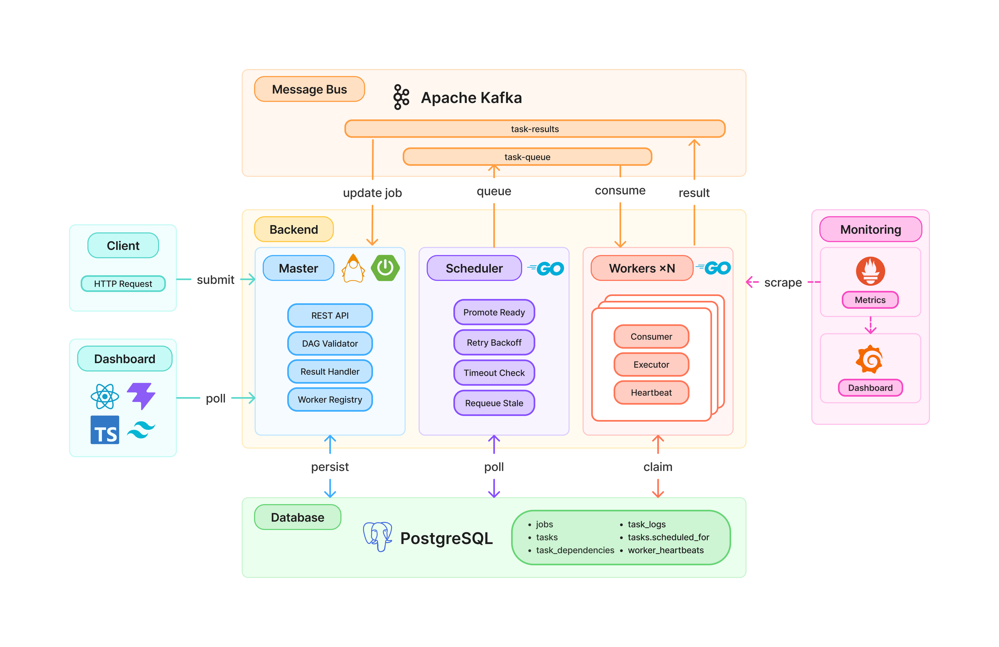

# Architecture — Distributed Task Orchestration Engine

## Table of Contents

1. [Design Goals](#1-design-goals)
2. [Component Overview](#2-component-overview)
3. [Task Lifecycle & State Machine](#3-task-lifecycle--state-machine)
4. [Master Node Internals](#4-master-node-internals)
5. [Scheduler Service Internals](#5-scheduler-service-internals)
6. [Worker Node Internals](#6-worker-node-internals)
7. [Kafka Message Design](#7-kafka-message-design)
8. [Database Schema](#8-database-schema)
9. [Concurrency & Locking Strategy](#9-concurrency--locking-strategy)
10. [Retry & Timeout Engine](#10-retry--timeout-engine)
11. [Monitoring & Observability](#11-monitoring--observability)

---

## 1. Design Goals

| Goal | How DTOE Achieves It |
|---|---|
| **At-least-once delivery** | Kafka offset is committed only after the task has been claimed |
| **No duplicate execution** | Claiming is a conditional `QUEUED → RUNNING` update: a stale or duplicate message updates 0 rows and is dropped |
| **Horizontal scale** | Stateless workers; add more to scale throughput |
| **Fault isolation** | Worker crash doesn't affect master or other workers |
| **Observable** | Every state transition is logged with timestamp + worker ID |
| **DAG correctness** | Topological sort ensures tasks never run before their dependencies |

---

## 2. Component Overview



- **Master (Java/Spring Boot)** — REST API, DAG validation, result consumer, worker registry. It never publishes work itself.
- **Scheduler (Go)** — the sole writer of `task-queue`: promotes dependency-ready tasks, applies retry backoff, enforces timeouts, requeues stranded `QUEUED` rows.
- **Workers (Go ×N)** — consume `task-queue`, claim each task with a conditional `QUEUED → RUNNING` update, execute it, publish to `task-results`, and heartbeat every 5s.
- **PostgreSQL** — `jobs`, `tasks`, `task_dependencies`, `task_logs`, `worker_heartbeats`.
- **Monitoring** — Prometheus scrapes all three services, Grafana renders the dashboards, and the React console polls the master API.

---

## 3. Task Lifecycle & State Machine

Every task moves through this state machine. State transitions are atomic — guarded by DB transactions.

```
┌────────────┐
Job submit │            │
──────────▶│  PENDING   │
            │            │
            └─────┬──────┘
                  │ All upstream deps are SUCCESS
                  │ Scheduler picks up task
                  ▼
            ┌────────────┐
            │   QUEUED   │◀──────────────────┐
            │            │                   │
            └─────┬──────┘   Retry (backoff delay)
                  │ Worker consumes message            │
                  ▼                   │
            ┌────────────┐      ┌─────┴──────┐
            │  RUNNING   │───── FAIL ───▶│  RETRYING  │
            │            │              │            │
            └─────┬──────┘              └────────────┘
                  │                         │
      ┌───────────┼──────────────┐          │ max retries exceeded
      │           │              │          │
   SUCCESS    TIMEOUT        FAIL ◀─────────┘
      │           │              │
      ▼           ▼              ▼
┌─────────┐ ┌──────────┐   ┌───────┐
│ SUCCESS │ │ TIMED_OUT│   │ FAILED│
└─────────┘ └──────────┘   └───────┘
```

### State Descriptions

| State | Meaning |
|---|---|
| `PENDING` | Task created, waiting for upstream dependencies |
| `QUEUED` | Published to Kafka, awaiting worker pickup |
| `RUNNING` | Worker has locked and is actively executing |
| `SUCCESS` | Task completed successfully |
| `FAILED` | Task failed and max retries exhausted |
| `RETRYING` | Task failed but will be re-queued after backoff |
| `TIMED_OUT` | Task exceeded its configured timeout |
| `CANCELLED` | User explicitly cancelled the parent job |

---

## 4. Master Node Internals

### 4.1 Job Ingestion Flow

```
POST /api/v1/jobs
      │
      ▼
JobController.submitJob()
      │
      ▼
DagValidationService
  - Validate JSON schema
  - Detect cycles in DAG (DFS)
  - Validate task types are registered
      │
      ▼
JobService.createJob()
  - Persist Job (status=RUNNING)
  - Persist all Tasks (status=PENDING)
  - Return job ID
      │
      ▼
Return { jobId, status, taskCount }
```

### 4.2 DAG Cycle Detection

Uses iterative DFS with a three-color marking:
- **WHITE** (unvisited) → **GRAY** (in current path) → **BLACK** (fully explored)

If we encounter a GRAY node during traversal, a cycle exists and the job is rejected.

### 4.3 Result Consumer

The master node consumes task results from Kafka:

```
Kafka Consumer receives TaskResultMessage
      │
      ▼
TaskResultConsumer.processResult()
      │
      ├── Update task status in database
      │
      ├── If SUCCESS:
      │     └── Check if downstream tasks are now ready
      │           └── (Scheduler will pick them up)
      │
      └── If FAILED:
            └── Check retry policy
                  └── Update status to RETRYING or FAILED
```

---

## 5. Scheduler Service Internals

The scheduler is a standalone Go service that handles task promotion and timeout enforcement.

### 5.1 Ready Task Promotion

Promotion and the status change happen in one statement, so any number of schedulers can run concurrently — each row is promoted exactly once:

```sql
WITH ready AS (
    SELECT t.id FROM tasks t
     WHERE t.status = 'PENDING'
       AND NOT EXISTS (
           SELECT 1 FROM task_dependencies td
           JOIN tasks dep ON dep.id = td.dependency_id
           WHERE td.task_id = t.id
             AND dep.status != 'SUCCESS'
       )
     ORDER BY t.created_at
     LIMIT $1
     FOR UPDATE SKIP LOCKED
)
UPDATE tasks SET status = 'QUEUED', queued_at = NOW(), updated_at = NOW()
 WHERE id IN (SELECT id FROM ready)
RETURNING ...;
```

- Due retries (`RETRYING` with `scheduled_for <= NOW()`) are claimed the same way.
- The message is published **after** the claim; if the Kafka write fails, the row is reverted to `PENDING` (or `RETRYING`) so the task is not lost.
- `QUEUED` rows older than five minutes are reverted to `PENDING` so a lost message cannot strand a task.

### 5.2 Timeout Enforcement

Timeout enforcement reads `RUNNING` rows whose `started_at` is older than `(timeout_seconds + 30s grace)`, then either schedules a retry (`RETRYING` with `scheduled_for`) or marks the task `TIMED_OUT`:

```sql
SELECT ... FROM tasks
 WHERE status = 'RUNNING'
   AND started_at < NOW() - ((timeout_seconds + $1) * INTERVAL '1 second')
```

The grace period lets a worker that is already finishing publish its own result before the scheduler reaps the task.

### 5.3 Configuration

| Environment Variable | Default | Description |
|---|---|---|
| `DTOE_SCHEDULER_POLL_INTERVAL_MS` | `5000` | Polling interval for ready tasks |
| `DTOE_SCHEDULER_TIMEOUT_CHECK_MS` | `10000` | Timeout check interval |
| `DTOE_DATABASE_HOST` | `localhost` | PostgreSQL host |
| `DTOE_KAFKA_BROKERS` | `localhost:9092` | Kafka bootstrap servers |

---

## 6. Worker Node Internals

### 6.1 Task Execution Flow

```
Kafka Consumer receives TaskMessage
      │
      ▼
Consumer.processTask()
      │
      ├── claimTask(): UPDATE ... WHERE id = $2 AND status = 'QUEUED'
      │     └── 0 rows affected → discard the message
      │           (already claimed, cancelled, or finished)
      │
      ├── Insert task log, resolve TaskHandler by task.type
      │
      ├── Execute with timeout via context.WithTimeout
      │
      ├── On SUCCESS / FAILED / TIMED_OUT:
      │     └── Publish TaskResultMessage to task-results
      │
      └── Commit the Kafka offset once the message is handled
```

### 6.2 TaskHandler Interface

Workers are extensible through the `TaskHandler` interface:

```go
type TaskHandler interface {
    Execute(ctx context.Context, payload map[string]interface{}) (map[string]interface{}, error)
}
```

Built-in handlers:
- `HTTPRequestHandler` — makes HTTP calls, validates status codes
- `ShellCommandHandler` — runs shell scripts
- `NoOpHandler` — for testing and DAG validation

### 6.3 Heartbeat Service

Every worker writes a heartbeat every 5 seconds:

```go
func (s *Service) SendHeartbeat(ctx context.Context) error {
    query := `
        INSERT INTO worker_heartbeats (worker_id, hostname, active_tasks, capacity, last_seen_at, started_at)
        VALUES ($1, $2, $3, $4, NOW(), NOW())
        ON CONFLICT (worker_id) DO UPDATE SET
            hostname = EXCLUDED.hostname,
            active_tasks = EXCLUDED.active_tasks,
            capacity = EXCLUDED.capacity,
            last_seen_at = NOW()
    `
    // Execute upsert
}
```

The master dashboard marks workers **DEAD** if their last heartbeat is older than 60 seconds.

---

## 7. Kafka Message Design

### Topics

| Topic | Partitions | Retention | Purpose |
|---|---|---|---|
| `task-queue` | 12 | 7 days | Task dispatch from scheduler to workers |
| `task-results` | 12 | 7 days | Result reporting from workers to master |
| `worker-events` | 3 | 1 day | Worker lifecycle events (optional) |

### Partition Strategy

Tasks are partitioned by `jobId` — all tasks of the same job land on the same partition. This ensures **ordered processing within a job** while still allowing **parallel execution across jobs**.

### Message Schemas

**TaskMessage** (scheduler → worker):
```json
{
  "taskId": "uuid",
  "jobId": "uuid",
  "type": "HTTP_REQUEST",
  "payload": { ... },
  "timeoutSeconds": 30,
  "retryCount": 0,
  "maxRetries": 3,
  "enqueuedAt": "2024-01-01T00:00:00Z"
}
```

**TaskResultMessage** (worker → master):
```json
{
  "taskId": "uuid",
  "jobId": "uuid",
  "workerId": "worker-abc123",
  "status": "SUCCESS",
  "output": { ... },
  "errorMessage": null,
  "startedAt": "2024-01-01T00:00:00Z",
  "completedAt": "2024-01-01T00:00:05Z"
}
```

---

## 8. Database Schema

```sql
-- Jobs: the top-level unit of work
CREATE TABLE jobs (
    id UUID PRIMARY KEY DEFAULT gen_random_uuid(),
    name VARCHAR(255) NOT NULL,
    status VARCHAR(50) NOT NULL DEFAULT 'RUNNING',
    submitted_by VARCHAR(255),
    created_at TIMESTAMPTZ NOT NULL DEFAULT NOW(),
    updated_at TIMESTAMPTZ NOT NULL DEFAULT NOW(),
    completed_at TIMESTAMPTZ
);

-- Tasks: individual units within a job
CREATE TABLE tasks (
    id UUID PRIMARY KEY DEFAULT gen_random_uuid(),
    job_id UUID NOT NULL REFERENCES jobs(id) ON DELETE CASCADE,
    name VARCHAR(255) NOT NULL,
    type VARCHAR(100) NOT NULL,
    payload JSONB,
    status VARCHAR(50) NOT NULL DEFAULT 'PENDING',
    retry_count INTEGER NOT NULL DEFAULT 0,
    max_retries INTEGER NOT NULL DEFAULT 3,
    timeout_seconds INTEGER NOT NULL DEFAULT 60,
    worker_id VARCHAR(255),
    created_at TIMESTAMPTZ NOT NULL DEFAULT NOW(),
    updated_at TIMESTAMPTZ NOT NULL DEFAULT NOW(),
    queued_at TIMESTAMPTZ,
    started_at TIMESTAMPTZ,
    completed_at TIMESTAMPTZ,
    error_message TEXT,
    output JSONB
);

-- Task dependency graph (edges of the DAG)
CREATE TABLE task_dependencies (
    task_id UUID NOT NULL REFERENCES tasks(id) ON DELETE CASCADE,
    dependency_id UUID NOT NULL REFERENCES tasks(id) ON DELETE CASCADE,
    PRIMARY KEY (task_id, dependency_id)
);

-- Task execution logs
CREATE TABLE task_logs (
    id BIGSERIAL PRIMARY KEY,
    task_id UUID NOT NULL REFERENCES tasks(id) ON DELETE CASCADE,
    worker_id VARCHAR(255),
    level VARCHAR(10) NOT NULL DEFAULT 'INFO',
    message TEXT NOT NULL,
    logged_at TIMESTAMPTZ NOT NULL DEFAULT NOW()
);

-- Worker registry and health
CREATE TABLE worker_heartbeats (
    worker_id VARCHAR(255) PRIMARY KEY,
    hostname VARCHAR(255) NOT NULL,
    active_tasks INTEGER NOT NULL DEFAULT 0,
    capacity INTEGER NOT NULL,
    last_seen_at TIMESTAMPTZ NOT NULL DEFAULT NOW(),
    started_at TIMESTAMPTZ NOT NULL DEFAULT NOW()
);

-- Indexes for common query patterns
CREATE INDEX idx_tasks_job_id ON tasks(job_id);
CREATE INDEX idx_tasks_status ON tasks(status);
CREATE INDEX idx_tasks_status_started_at ON tasks(status, started_at) WHERE status = 'RUNNING';
CREATE INDEX idx_task_logs_task_id ON task_logs(task_id);
CREATE INDEX idx_worker_heartbeats_last_seen ON worker_heartbeats(last_seen_at);
```

---

## 9. Concurrency & Locking Strategy

### The duplicate-delivery problem

Kafka is at-least-once: during a rebalance the same message can be delivered twice, and a message can arrive for a task that was cancelled or already executed. DTOE does not use advisory locks; it relies on atomic state transitions, so exactly one consumer can act on a task.

### Worker claim

`claimTask` issues a conditional update and inspects the affected row count:

```go
tag, err := c.dbPool.Exec(ctx, `
    UPDATE tasks
       SET status = 'RUNNING', started_at = NOW(), completed_at = NULL,
           error_message = NULL, worker_id = $1, updated_at = NOW()
     WHERE id = $2 AND status = 'QUEUED'`, c.workerID, taskID)
if tag.RowsAffected() != 1 {
    // another worker owns it, or it was cancelled/reaped — drop the message
}
```

The Kafka offset is committed only after the claim succeeds, so a crash between fetch and claim leaves the message for redelivery.

### Scheduler promotion

`ClaimReadyTasks` / `ClaimRetryTasks` select and update inside one statement (`WITH ... FOR UPDATE SKIP LOCKED` + `UPDATE ... RETURNING`), so multiple schedulers can run safely: every row is promoted exactly once.

### Result handling

The master accepts a result only while the task is `RUNNING`; a late result for a task the scheduler already reaped or retried cannot overwrite the newer state.

---

## 10. Retry & Timeout Engine

### Retry Policy

Each task has configurable `maxRetries` (default: 3). On failure:

1. `retry_count` is incremented
2. If `retry_count < max_retries` → status transitions to `RETRYING`
3. A delayed re-queue is scheduled using exponential backoff: `delay = 2^retryCount * baseDelaySeconds`
4. If `retry_count >= maxRetries` → status transitions to `FAILED`

### Timeout Handling

The scheduler polls for timed-out tasks:

```go
func (s *Scheduler) EnforceTimeouts(ctx context.Context) error {
    tasks, err := s.repo.FindTimedOutTasks(ctx)
    // ...
    for _, task := range tasks {
        s.repo.SetTaskTimedOut(ctx, task.ID)
        if s.repo.CanRetry(task) {
            s.repo.IncrementRetryCount(ctx, task.ID)
            s.enqueueTask(ctx, task)
        } else {
            s.repo.SetTaskFailed(ctx, task.ID)
        }
    }
}
```

---

## 11. Monitoring & Observability

### Monitoring Stack

```
┌──────────────────────────────────────────────────────────────────┐
│ PROMETHEUS (port 9090)                                           │
│ Scrapes metrics from all services                                │
│ - dtoe-master:8080/actuator/prometheus                           │
│ - dtoe-scheduler:8081/metrics                                    │
│ - dtoe-worker:8082/metrics                                       │
└──────────────────────────────────────────────────────────────────┘
                              │
                              ▼
┌──────────────────────────────────────────────────────────────────┐
│ GRAFANA (port 3001)                                              │
│ Default credentials: admin / admin                               │
│ Pre-configured Prometheus data source                            │
│ Dashboards for job/task/worker monitoring                        │
└──────────────────────────────────────────────────────────────────┘
```

### Web Console

React 18 + TypeScript + Vite + Tailwind, served by nginx on port 3000. `/api` is proxied to the master; in development Vite proxies it to `localhost:8080`.

| Route | Purpose |
|---|---|
| `/` | Cluster overview: totals, success rate, recent jobs, active workers |
| `/jobs` | Search (`q`), status filter, page size and pagination held in the URL |
| `/jobs/:jobId` | Summary, `Graph` / `Table` pipeline views, click-to-inspect step panel |
| `/tasks` | Task search across name/type/job, status filter, pagination |
| `/tasks/:taskId` | Definition (command + payload), error, output, logs, containing pipeline |
| `/workers` | Active workers by default, opt-in inactive history |

The DAG view is React Flow with a dagre layout: nodes are coloured by task status, edges by dependency, and selecting a node fills the inspector with its payload/command, timings, worker and error. The same component renders a live preview while a job is being created.

### Key Metrics

#### Scheduler Metrics
- `dtoe_scheduler_tasks_promoted_total` - Tasks promoted to queue
- `dtoe_scheduler_poll_duration_seconds` - Poll loop duration
- `dtoe_task_timeouts_total` - Task timeouts detected
- `dtoe_task_retries_total` - Task retries scheduled

#### Worker Metrics
- `dtoe_worker_tasks_executed_total{type, status}` - Tasks by type and result
- `dtoe_worker_task_execution_duration_seconds{type}` - Task duration histogram
- `dtoe_worker_tasks_in_flight` - Currently executing tasks
- `dtoe_worker_heartbeat_sent_total` - Heartbeats sent

#### Kafka Metrics
- `dtoe_kafka_messages_produced_total` - Messages sent to Kafka
- `dtoe_kafka_messages_consumed_total` - Messages received from Kafka
- `dtoe_kafka_produce_errors_total` - Kafka produce errors
- `dtoe_kafka_consume_errors_total` - Kafka consume errors

### Health Endpoints

| Service | Endpoint | Port |
|---|---|---|
| Master | `GET /actuator/health` | 8080 |
| Scheduler | `GET /health` | 8081 |
| Worker | `GET /health` | 8082 |

### Prometheus Metrics Endpoints

| Service | Endpoint | Description |
|---|---|---|
| Master | `GET /actuator/prometheus` | JVM, thread pool, Kafka metrics |
| Scheduler | `GET /metrics` | Tasks promoted, Kafka produced, poll duration |
| Worker | `GET /metrics` | Tasks executed, task duration, heartbeat stats |

### Console Data Sources

| Panel | Endpoint | Refresh |
|---|---|---|
| Overview counters (jobs, tasks, active workers, success rate) | `GET /jobs?size=100`, `GET /tasks?size=1`, `GET /workers` | 5s |
| Job list (search, filter, paging) | `GET /jobs?q&status&page&size` | 5s |
| Job pipeline (graph / table) | `GET /jobs/{id}` | 5s while `RUNNING` |
| Task list (search, filter, paging) | `GET /tasks?q&status&page&size` | 5s |
| Task detail + logs | `GET /tasks/{id}`, `GET /tasks/{id}/logs` | 5s while active |
| Worker list (active, inactive) | `GET /workers` | 5s |

### Worker Health States

`dead_threshold` defaults to 60s (`DTOE_WORKER_DEAD_THRESHOLD_SECONDS`); stale is a quarter of it.

| State | Condition | Indicator |
|---|---|---|
| **HEALTHY** | Heartbeat < 15s old, free slots | 🟢 Green |
| **BUSY** | Heartbeat fresh, `active_tasks >= capacity` | 🔵 Blue |
| **STALE** | Heartbeat 15–60s old | 🟠 Amber |
| **DEAD** | No heartbeat, or older than 60s | 🔴 Red |

Worker IDs are generated per process, so restarts leave rows behind. The master's `WorkerHeartbeatCleanup` job deletes rows older than `dtoe.worker.retention-hours` (default 24h via `DTOE_WORKER_RETENTION_HOURS`, `0` disables) every 10 minutes; the console still hides inactive workers by default.

### Metrics (Master - Spring Actuator)

- `GET /actuator/health` — liveness and readiness
- `GET /actuator/metrics` — JVM, thread pool, Kafka consumer lag
- `GET /actuator/info` — build version, instance ID
